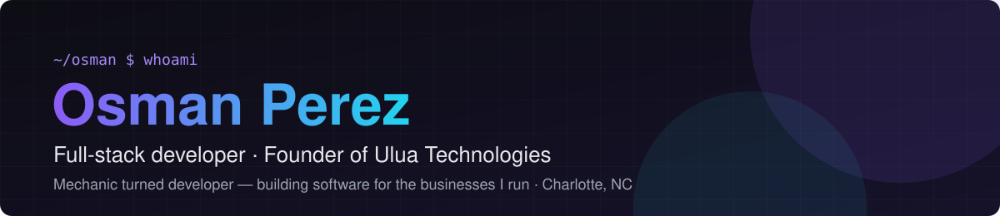
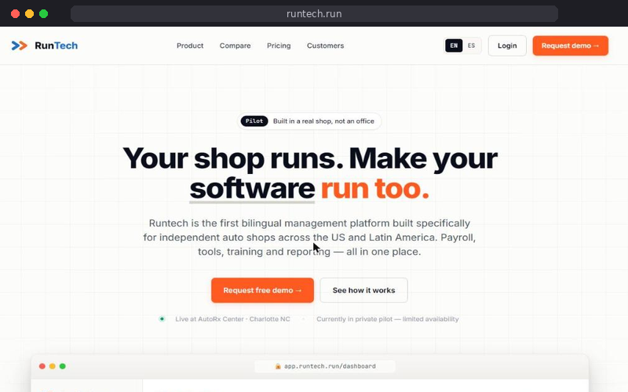
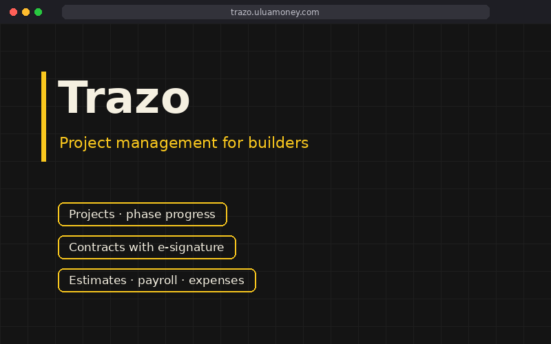
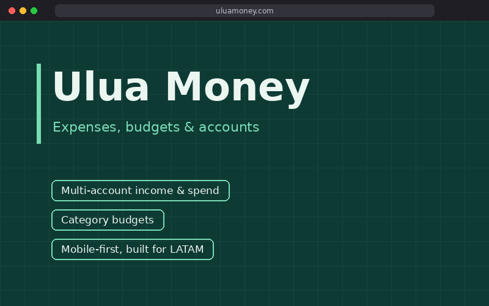
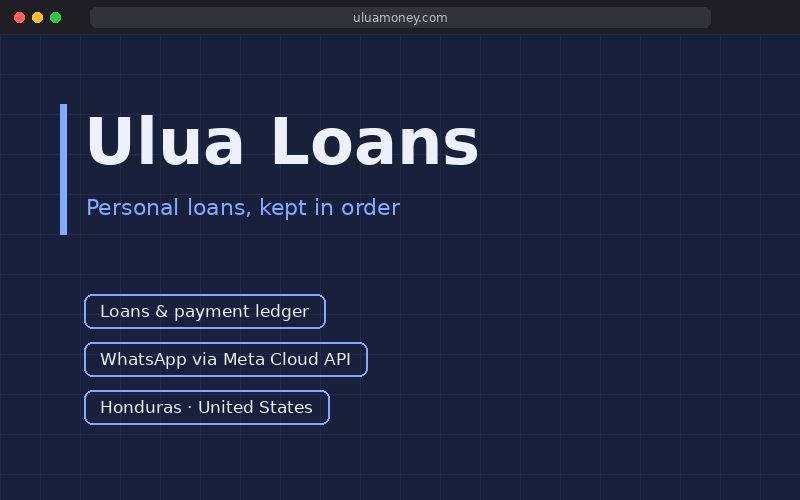
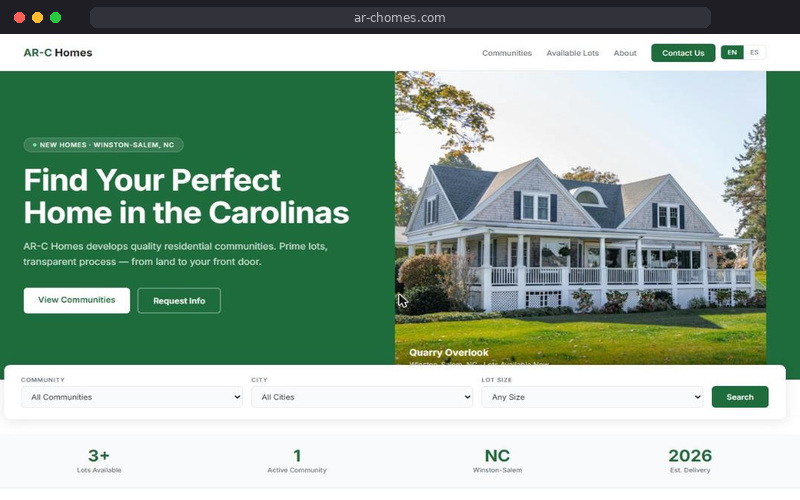
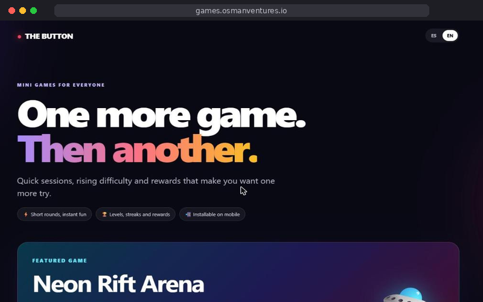

  

  
  
  
  

I spent years under the hood as a mechanic, then started writing the software my own businesses were missing. Today I run an auto repair shop in Charlotte, NC, develop land in North Carolina, and build SaaS products under **Ulua Technologies LLC** — every app below started as a real problem in a real business, and most of them are used in production by the people who asked for them.

**What I focus on:** multi-tenant SaaS, bilingual (EN/ES) products for the US and Latin America, and integrations with the tools small businesses already use.

---

## 🚀 Project showcase

<table>
  <tr>
    <td width="50%" valign="top">
      
      <h3>RunTech </h3>
      
Bilingual management platform for independent auto repair shops — payroll, tools, training, hiring and reporting in one place. Running in production at a Charlotte shop.

      
Multi-tenant · modular architecture (Core / Platform / Modules) · event bus · per-tenant feature flags · Tekmetric POS sync.

      

        
        
        
        
      

      <a href="https://runtech.run"><b>runtech.run →</b></a>
    </td>
    <td width="50%" valign="top">
      
      <h3>Trazo </h3>
      
Job-site management for builders in Latin America — projects with phase progress, contracts created and signed in-app (or printed for a notary and uploaded back), estimates, payroll and expenses.

      
Role-based access for owners, clients and subcontractors.

      

        
        
        
      

      <a href="https://trazo.uluamoney.com"><b>trazo.uluamoney.com →</b></a>
    </td>
  </tr>
  <tr>
    <td width="50%" valign="top">
      
      <h3>Ulua Money </h3>
      
Free personal-finance app for Latin America: expenses, income, budgets and every account in one place. Mobile-first and Spanish-first.

      

        
        
        
      

      <a href="https://uluamoney.com"><b>uluamoney.com →</b></a>
    </td>
    <td width="50%" valign="top">
      
      <h3>Ulua Loans </h3>
      
Ledger for personal loans between people in Honduras and the US — balances, payments and history, with WhatsApp messaging through the Meta Cloud API.

      

        
        
        
      

    </td>
  </tr>
  <tr>
    <td width="50%" valign="top">
      
      <h3>AR-C Homes </h3>
      
Bilingual website for a residential land-development company in Winston-Salem, NC, plus an internal cost tracker for the partners (7 phases, 47 cost categories, role-based access).

      

        
        
        
      

      <a href="https://ar-chomes.com"><b>ar-chomes.com →</b></a> · <a href="https://github.com/Ulua-Technologies-LLC/ar-chomes-website">code</a>
    </td>
    <td width="50%" valign="top">
      
      <h3>El Botón · Mini games </h3>
      
Side project: quick-session browser games with levels, streaks and a global leaderboard. Installable on mobile, EN/ES.

      

        
        
        
      

      <a href="https://games.osmanventures.io"><b>Play →</b></a> · <a href="https://github.com/Ulua-Technologies-LLC/el-boton">code</a>
    </td>
  </tr>
</table>

Most production code lives in private repositories under <a href="https://github.com/Ulua-Technologies-LLC">Ulua Technologies LLC</a>. Happy to walk through architecture and code on a call.

---

## 🧰 Tech I use

  
  
  
  
  
  
  
  
  
  
  
  
  
  
  

## 📫 Contact

[osmanventures.io](https://osmanventures.io) · open to custom builds for small businesses in the US and Latin America.
